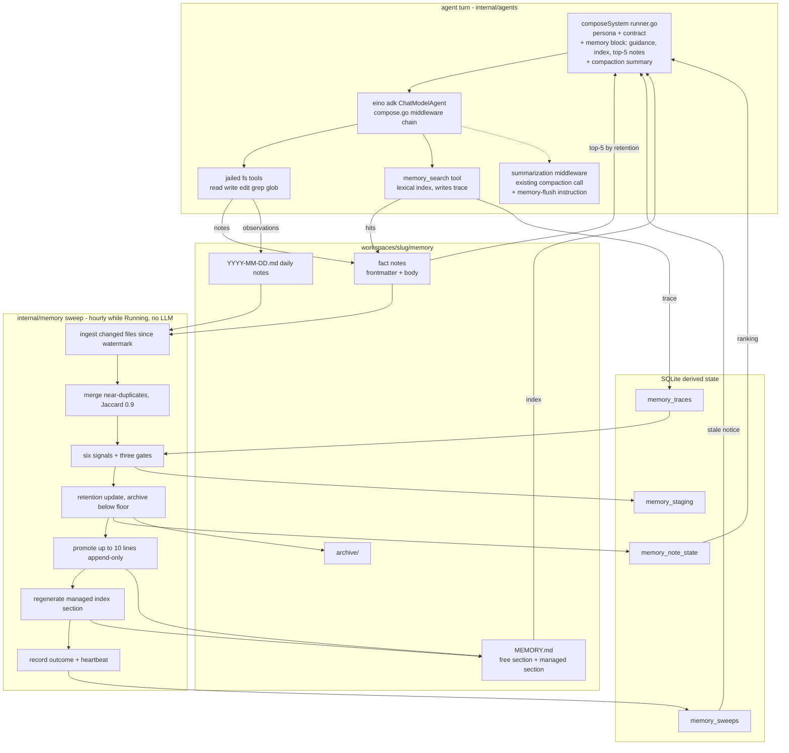
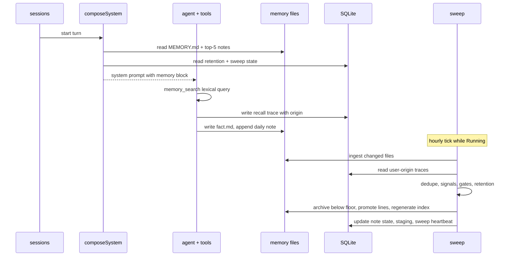

# Design

## Context

See proposal.md — Why. The substrate this design builds on, verified against the code on 2026-10-26:

- **Per-turn composition seam**: `composeSystem` in `internal/agents/runner.go` assembles persona (IDENTITY/SOUL/BOOTSTRAP read from disk each turn via `PromptDocs`), the virtual operating contract, the document-preset appendix, knowledge guidance, and the compaction summary, in a pinned order. The memory block slots between the contract and the compaction summary without touching the contract.
- **Tools**: the middleware chain in `internal/agents/compose/compose.go` registers the jailed filesystem tools (`read`/`write`/`edit`/`grep`/`glob` over the workspace) and the knowledge mount; builtin tools follow the `save_document`/`create_document` pattern; skills are seeded like `internal/knowledge/skill.go`.
- **Retrieval primitives today**: lexical grep over files only. No FTS5, no embeddings, no graph. Storage is `modernc.org/sqlite` (pure Go) with WAL and a busy timeout.
- **Transcript**: `session_events` is an append-only JSON event log readable by seq-cursor — mechanically indexable, but not needed by this change (it is the Phase 3 corpus).
- **Scheduler**: fires LLM turns only (`internal/scheduler/runs.go`); its ticker attaches to the gateway loop and respects Running/Paused.
- **Reference designs** (the explore record holds the full survey): OpenClaw's memory-core dreaming sweep (deterministic signals, gates, and an append-only fallback that this design makes primary), Hermes Agent's ~800-token budgeted file, ByteRover's agent-curated context tree, SF-AMS's survival-potential retention formula, SCM's sleep-cycle arithmetic, and the "Memory as Infrastructure" harness report's decision-determinism and reliability lessons.

Hard constraint: no additional model call anywhere in the memory path.

## Goals / Non-Goals

**Goals:**
- Memory that works on day one with only the tools the agent already has, and degrades to "plain files the user can read" in every failure case.
- A consolidation sweep that is deterministic, idempotent, bounded, and observable — the model is never the judge of its own memory's health or relevance.
- Byte-stable injected content between sweeps so prefix caching is not defeated by memory.
- A layout portable to OpenClaw-class harnesses.

**Non-Goals (design-level, beyond the proposal's scope line):**
- Semantic (paraphrase) recall. Lexical recall plus the `concepts` field and the skill's query-refinement playbook is the v1 bar; Phase 3's graph adds association.
- Contradiction *detection*. The agent declares `supersedes`/`contradicts` in-turn; the sweep only acts on declarations. Mechanical detection and LLM resolution are Phase 3/4 concerns.
- Cross-agent or global memory. Memory is per workspace; global knowledge already exists as the knowledge corpus.
- Any configuration surface. Constants are fixed defaults in code for v1.

## Decisions

### D1. Files are the source of truth; the database holds only derived, rebuildable state
Markdown in `workspaces/<slug>/memory/` is what the agent reads and writes with its existing tools, what the user can open and edit, and what travels between harnesses. SQLite holds recall traces, retention state, staging state, and sweep state — all reconstructible from files plus traces. *Alternative*: a notes table as the source of truth (the predecessor's approach) — rejected because it forces a bespoke tool for every read/write, breaks user editability, and is the start of the pipeline this change exists to avoid.

### D2. In-turn curation replaces extraction
The agent writes notes during its own generation, guided by the memory block and the `memory` skill. No extraction subagent, no summarizer. The pre-compaction "memory flush" that OpenClaw implements as a private model turn is obtained for free here by folding one instruction ("record durable facts to memory before the summary") into the **existing** compaction summarization prompt in `compose.go` — zero extra calls. *Alternative*: a jailed extraction subagent (the 2026-10-22 explore's v2) — explicitly rejected by the constraint.

### D3. Memory block placement and budgets
Position: after the operating contract, before the compaction summary. Index budget: 3,200 characters (≈ 800 tokens, Hermes' operating point), truncating the injected copy only. Notes section: top-5 by retention above the injection threshold, 6,000 characters total; absent when nothing qualifies (silence as default — the harness report's precision-over-recall rule). *Alternative*: inject every note (ZCode's wholesale index) — rejected because it grows without bound and the data-management study found unfiltered accumulation degrades below no-memory.

### D4. Frontmatter schema
`name`, `description`, `type ∈ {user, feedback, project, reference}` (ZCode's proven taxonomy), `concepts`, `relations` using SCM's six predicates (`has_property`, `prefers`, `related_to`, `contradicts`, `causes`, `part_of`), `supersedes`, plus `[[wiki-links]]` in the body. Relations and links are authored by the agent in-turn — they are Phase 3's graph edges, captured now at zero cost. The sweep adds no frontmatter the agent must maintain; derived scores live in the database.

### D5. Lexical search as a Go inverted index, no FTS5 in this change
`memory_search` tokenizes note frontmatter, bodies, daily notes, and the index into a per-agent in-memory inverted index (lowercased terms, code identifiers and backticked spans preserved as single terms), scoring by term overlap weighted by inverse document frequency, with a small boost for matches in `name`/`description`/`concepts`. The index is rebuilt by the sweep and refreshed on demand when a file's mtime changed since the last build. A few hundred small files per agent is well under what a hand-rolled index handles in microseconds. *Alternative*: SQLite FTS5 — deferred to Phase 3 behind a driver spike; the harness report hit FTS5/DB-lock contention, and this change has no need for it.

### D6. Recall traces are the signal source
Every `memory_search` call writes a trace (origin, query, hits, scores). This is the one piece OpenClaw gets from its `memory_search` tool that grep-recall cannot provide; without traces, none of the frequency/diversity/relevance signals exist. The tool exists primarily to generate them; its search quality is secondary. *Alternative*: mining user messages for terms to infer recalls — rejected as fragile and unfalsifiable.

### D7. The sweep runs on its own gateway-aware goroutine
`internal/memory` owns a ticker modeled on `internal/scheduler/ticker.go`: one sweep per agent per hour while Running, skipped while Paused, with an on-demand entry point. *Alternative*: extending the scheduler with a non-LLM job type — rejected because the scheduler's contract is "a prompt fires an agent session"; bending it to run Go jobs muddies a user-facing spec for an internal concern.

### D8. Scoring — OpenClaw's six signals and three gates, verbatim
Candidate score = 0.30·relevance + 0.24·frequency + 0.15·diversity + 0.15·recency(14-day half-life) + 0.10·consolidation + 0.06·concept density, each normalized to [0,1]; promote only when score ≥ 0.8 **and** recalls ≥ 3 **and** distinct queries ≥ 3; at most 10 promotions per sweep; staging expires after 30 days. These are battle-tested constants from a shipped system, adopted unchanged so tuning starts from a known-good point.

### D9. Retention — SF-AMS survival potential with mechanical importance
Per note: `Φ ← max(0, Φ + I·Γ·Ψ − λ·Δt_days)`, where `I = 0.35·novelty + 0.45·relevance + 0.20·repetition` (novelty = 1 − max token-set similarity to existing notes at first sight; relevance = mean trace hit score; repetition = recall share), `Γ` = user-origin recalls since the last sweep (capped at 5), `Ψ` = 1 − max similarity to any higher-retention note (redundancy dampening), `λ` = 0.02 per day, initial `Φ = I`. Archive floor 0.1; injection threshold 0.3; 30-day creation grace regardless of Φ. *Alternative*: plain Ebbinghaus decay — adopted SF-AMS instead because its usage and redundancy gates were shown to beat LRU/FIFO eviction and it is the same arithmetic cost.

### D10. Promotion is append-only into a managed index section
Promoted daily-note lines are appended verbatim with `Source: memory/YYYY-MM-DD.md#Lnn` and the date, under markers the sweep owns; the free section above the markers is never touched. This is OpenClaw's append-only fallback made primary, and the data-management study's finding that localized maintenance beats global reorganization. Merging and rewriting are deliberately not done without a model.

### D11. Archive, never delete; 30-day grace
Notes whose Φ falls below the floor move to `memory/archive/` (restorable by moving back); nothing is deleted; nothing is archived within 30 days of creation. Near-duplicate candidates (token-set Jaccard ≥ 0.9) merge before scoring. This bounds growth — the lesson from Hippo (accumulated memory eventually underperforms no memory) — without the irreversibility OpenClaw's own issue thread warned against.

### D12. Origin gate
Traces carry origin (`user`, `scheduler`, `subagent`, `other`); only `user` counts. Mirrors OpenClaw's structural taint gate (only interactive sessions are eligible) so unattended or delegated runs cannot reinforce memory by looping over it. Child turns get no memory block, consistent with the existing persona-only child contract.

### D13. Heartbeat and staleness
Sweep state records start/finish/outcome/counts; if no success within 2× the interval while Running, the memory block says so. This is the harness report's "silent memory-system death" failure mode addressed with its own remedy: cold is not dead, but dead must be visible.

### D14. Byte stability
The managed index section is regenerated deterministically (stable ordering, no timestamps except on promoted entries) so an unchanged memory state yields a byte-identical file and a byte-identical injected block — keeping the prompt prefix cacheable across turns.

## Runtime flow

## Risks / Trade-offs

- [Lexical recall misses paraphrased queries] → the `concepts` field and the skill's "refine the query" playbook; `name`/`description` boosts; Phase 3 adds graph association.
- [The agent writes low-value notes] → the type taxonomy and skill guidance narrow what qualifies; retention decay and the archive bound the damage; nothing is injected below threshold.
- [Sweep reads a file mid-write by the agent] → the sweep skips files modified within the last 10 seconds and re-reads on the next tick; note writes are whole-file writes through the existing tools.
- [SQLite lock contention between sweep and turn writes] → the existing WAL + busy-timeout configuration; sweep writes are batched in one short transaction per agent; traces are single-row inserts.
- [Prompt growth defeats the prefix cache] → fixed budgets, deterministic managed section, no per-turn timestamps in the block.
- [Frontmatter YAML edge cases] → parse failures skip the note with a logged reason; never fatal.
- [Constants wrong for real usage] → every constant is a named default in one place; the sweep records counts so tuning has data; no user-facing config until the numbers settle.
- [Retention decays a note the user still needs but rarely recalls] → archive is a move, not a delete; the index and the archive directory are plain files the user can inspect and restore.

## Migration Plan

1. Additive migration adds the four `memory_*` tables; no existing table changes, no data backfill.
2. `memory/` and `memory/archive/` are created on demand at the first turn; workspaces that predate the change need nothing.
3. The sweep starts with the gateway and is inert for agents without a `memory/` directory.
4. Rollback: stop registering the tool and the block, stop the sweep; the migration is harmless to leave in place, and memory files are plain Markdown that the user keeps.

## Open Questions

- Exact injection threshold and `λ`: the defaults above are starting points; the sweep's recorded counts decide the tuning. Changing them changes no spec.
- Whether to surface sweep state in the UI (a memory tab in the right bar): deferred to a UI change once the backend has run for a while.
- The verified-outcome signal (a user correction as a negative signal) and the FTS5-on-`modernc.org/sqlite` spike are Phase 3 inputs, not needed here.
- The in-run summarization safety net (`SummarizationCapability` in `internal/agents/compaction/summarization.go`) exposes no instruction input: eino's middleware accepts the memory-flush line only by overriding its entire `UserInstruction` summarization prompt, so the flush rides the pre-turn compaction prompt (`SummarizeSystemPrompt`) alone and the in-run safety-net call stays unmodified.
